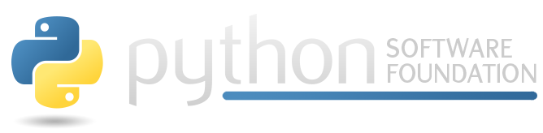
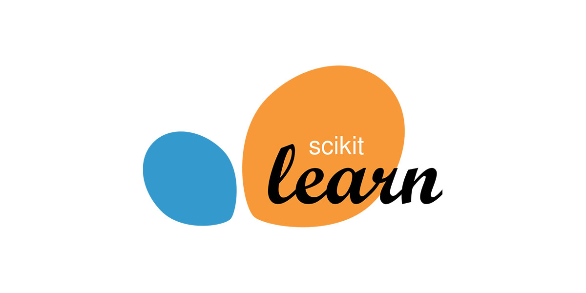
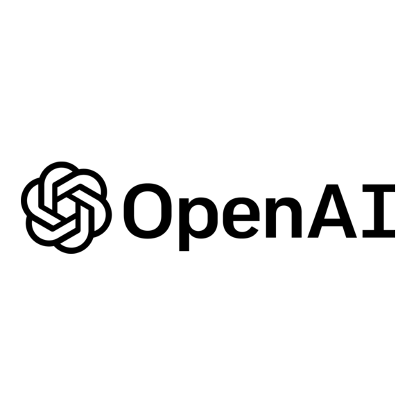

# Ineligencia Artificial
## Introducion
La inteligencia artificail (IA) es un area de la Ingenieria En Sistemas que busca desarollar programas y sistemas capases de realizar tareas que normalmente que normalmene requiera inteligencia humana.

Actualmente, la (IA) se utliza en areas como la educacion, la medicina, las empresas, la seguridad y e desarrollo de sotfware. Para desarrollar soluciones de Inteligencia Artificial se utilizan diferentes lenguajes, herramientas y lataformas tecnologicas.

## 1. Python
### Uso principal

Python es un lenguaje de programacion utilizado para dearrollar aplicasiones de inteligencia artificial aprendisaje automatico y analisis de datos

### Compañia que lo utiliza

Google utiliza python en diferentes proyectos y herramientas relaciondas con el desarrollo de sotfware y la inteligencia artificial empresas como Apple la usa en Fabricación de hardware informático, Capital One la usa para Servicios financieros entres y otras empresas la usan

### Enlace de refernencia
sitio ofiicial de python 

https://www.python.org

https://theirstack.com/es/technology/python

### imagen
()

## 2. TensorFlow
### Uso Principal

TensorFlow es una plataforma de codigos abiertos utilizada para desarrollar y entrenar modelos de inteligencia artificialy aprendisajes automatico

## Compañia que la utiliza
Google desarrollo TensorFlow y lo utiliza en diferentes proyectos relacionados con la inteligencia  Artificial y aprendisaje empresas como: Amazon, Mercor, Accentuare entre otras.

### Enlace de refrencia 
sitio oficial de TensorFlow
(https://www.tensorflow.org)

https://theirstack.com/es/technology/tensorflow

### imagen
()

## 3. PyTorch
### Uso principal

PyTorch es una biblioteca de codigos abiertos utilzada para crear y entrenar modelos de inteligencia Artificial y aprendisajes automatico. Es especialmente utilizada en investigaion y desarrollo de aplicasion de IA

### Compañia que la utilizan
Meta utiliza pytorch en proyectos de inteligencia Artificial y aprendisaje automatico empresas como: Apple, Tik Tok, Meta u otras emresas la usan

### Enlaces de referncia

sitio oficial de pytorch

(https://pytorch.org)

https://theirstack.com/es/technology/pytorch
### imagen
()
## 4. Scikit-learn
### Uso principal

es una biblioteca de código abierto diseñada para desarrollar modelos de aprendizaje automático en Python.

Scikit-learn hace que se utilice en sectores muy diferentes, desde empresas tecnológicas hasta laboratorios de investigación. Su facilidad para desarrollar modelos predictivos y analizar datos lo ha convertido en una herramienta habitual dentro de proyectos de inteligencia artificial y ciencia de datos.

### Compañia que la utiliza
es utilizada por empresas y desarrolladores para crear soluciones de aprendisaje automatico y analisis de datos empresas como NuMexico, UnDosTres, Klar u otras empresas la usan

### Enlaces de referencia

(https://scikit-learn.org)

https://universidadeuropea.com/blog/scikit-learn/#scikit-learn-casos

https://theirstack.com/es/technology/scikit-learn/mx
### imagen

##  5. Opena IA
### Uso principal 
La IA tiene la capacidad de mejorar muchos aspectos de la vida, y las herramientas de OpenAI ya están demostrando su potencial para transformar diferentes ámbitos de la sociedad.

Asistentes de voz: OpenAI ha trabajado en la creación de modelos de lenguaje natural que se utilizan en asistentes de voz, como Alexa de Amazon y Siri de Apple.

Traducción automática: OpenAI ha desarrollado modelos de lenguaje natural que pueden traducir automáticamente textos de un idioma a otro con una precisión impresionante.

Predicción del lenguaje: OpenAI ha desarrollado modelos de lenguaje natural que pueden predecir palabras y frases completas en función del contexto de una oración.

utomatización de tareas: OpenAI ha desarrollado herramientas de automatización que pueden realizar tareas repetitivas y monótonas de forma autónoma. Por ejemplo, la herramienta OpenAI Codex puede generar código automáticamente en función de una descripción en lenguaje natural de lo que se quiere lograr.

### Compañias que la utilizan
Amazon ha integrado la Inteligencia Artificial en prácticamente todos sus procesos, desde la cadena de suministro hasta la experiencia de compra.

Google es sin duda una de las compañías más emblemáticas en el uso de la Inteligencia Artificial. Su motor de búsqueda utiliza algoritmos de aprendizaje automático para ofrecer resultados cada vez más precisos y personalizados.

Tesla ha cambiado la percepción del automóvil gracias a la Inteligencia Artificial aplicada en sus vehículos eléctricos. 

### Enlaces de referencia
sitio oficial 

(https;//openai.com/)

https://www.inabaweb.com/

https://lainteligenciaartificial.blog/
### imagen

